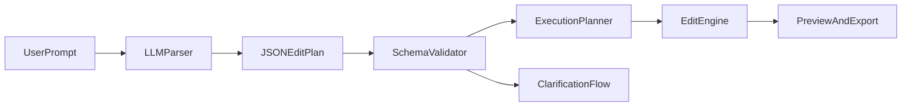

# LLM Prompt Parser Plan

Project-wide phases, hosting strategy, and non-parser roadmap live in **`docs/CURRENT_STATE_AND_ROADMAP.md`**. This file covers only the semantic parser, schema, and validation flow.

## Objective

Keep evolving the current LLM-based semantic parser so it translates user prompts into a validated internal edit plan more reliably than the rule-based fallback alone.

## Core Principle

The LLM should not directly edit the video.

It should only convert the user's prompt into structured JSON. The rest of the system should validate that JSON and execute the edit deterministically.

## Why This Is Better

An LLM parser can understand prompts like:

- `Change the GAME OVER text to BOTH`
- `Make the female character's hair pink throughout the clip`
- `Remove the fireworks behind the character`
- `Replace the crown with this flower`

without relying on brittle regex phrasing.

## Target Architecture



## Proposed Internal Schema

The parser should return a structure like:

```json
{
  "operation": "text_replacement",
  "target": {
    "type": "text",
    "value": "GAME OVER"
  },
  "replacement": {
    "type": "text",
    "value": "BOTH"
  },
  "scope": "whole_clip",
  "needs_reference": false,
  "confidence": 0.95,
  "needs_clarification": false,
  "clarification_question": null
}
```

## Supported Operation Families

**Implemented today** (see `core/edit_plan.SUPPORTED_OPERATIONS`):

- Text: `text_replacement`, `text_removal`, `text_detection`, `frame_extraction`
- Visual: `character_hair_recolor`, `object_recolor`, `object_remove`, `object_replace_guided`, `global_color_change`
- Timeline (FFmpeg): `timeline_trim`, `speed_change`, `crop_resize`, `volume_adjust`, `fade_in_out`, `rotate_flip`, `brightness_contrast`, `timeline_edit`
- Other: `atmosphere_overlay`, `auto_commentary`
- Premium: `codegen_edit`
- Rejected: `unsupported`, `unsupported_generative_edit`

**Parser coverage:** Timeline prompts are handled by **rule-based** parsing in `utils/timeline_parser_rules.py`. The Ollama LLM schema in `ParsedEditPlan` should be extended to include timeline operations and time fields — until then, rely on rules or expand the LLM prompt.

Legacy names in older docs (`hair_recolor`) map to `character_hair_recolor`.

## Suggested Free Model Options

### Local Development

Recommended starting parser models:

- `Qwen2.5 7B Instruct`
- `Qwen2.5 14B Instruct`
- `Llama 3.1 8B Instruct`
- `Mistral 7B Instruct`

Recommended local runtimes:

- `Ollama`
- `LM Studio`

Recommended first choice:

- `Ollama + Qwen2.5 7B`

This is a strong balance between quality, local usability, and future migration flexibility.

## Parsing Strategy

### Step 1: Try Structured Prompting

Send the user prompt plus:

- allowed operations
- JSON schema rules
- examples
- output-only-JSON instruction

### Step 2: Validate The Output

Reject the result if:

- required fields are missing
- the operation is unsupported
- types are invalid
- values are empty

### Step 3: Clarify When Needed

If the LLM is uncertain, it should return:

- `needs_clarification: true`
- `clarification_question: "..."`

Example:

- `Replace the crown`
- clarification: `What should the crown be replaced with?`

### Step 4: Normalize For Execution

Even with an LLM parser, execution still needs normalization:

- text cleanup for OCR matching
- prompt target normalization
- quote handling
- punctuation removal when needed

## Learning Strategy

Do not fine-tune immediately.

Start by collecting:

- original prompt
- parsed plan
- whether execution succeeded
- user correction if the parse was wrong

Then use those examples as few-shot prompt context.

This gives practical learning without training a new model yet.

## Future Fine-Tuning Path

Once enough real prompt data exists:

- build a dataset of prompt -> edit plan pairs
- build a dataset of prompt -> corrected edit plan pairs
- fine-tune a compact parser model later if needed

This should be treated as a later optimization, not the first step.

## Online Product Direction

When AiEdit moves online, parser isolation, quotas, and history align with **Phase 6** (and related bullets) in **`docs/CURRENT_STATE_AND_ROADMAP.md`**. This document does not duplicate that hosting plan.

## Short-Term Implementation Plan

1. Harden Ollama setup and status reporting so the LLM path is easy to enable locally.
2. Keep the current rule-based parser as a reliable fallback implementation.
3. Expand clarification behavior in the UI.
4. Log prompt parsing inputs and outputs.
5. Add prompt/correction memory for few-shot reuse.
6. Broaden support for more edit families while preserving schema validation.

## Current Implementation Status

The repo now has an initial implementation of this direction:

- local Ollama parsing support
- JSON extraction and schema validation
- fallback to the rule-based parser if Ollama is unavailable
- parser metadata such as backend and confidence surfaced in the app
- configurable `AIEDIT_OLLAMA_URL` and `AIEDIT_OLLAMA_MODEL` environment variables

Still pending:

- persisted prompt/correction history
- stronger clarification UX
- dedicated parser service for online deployment

## Non-Goals For The Parser

The parser should not:

- perform OCR
- detect objects
- segment masks
- directly modify frames
- bypass schema validation

Its only job is prompt understanding.
